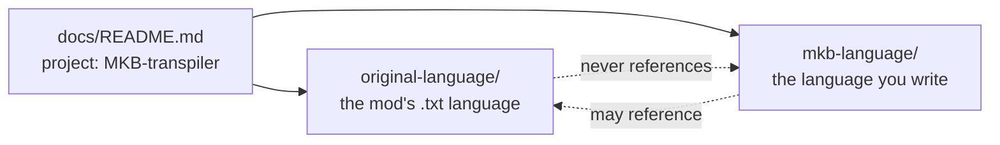

# Documentation

Three kinds of documentation live under `docs/`, and the dependency between them
only points one way.



| Doc set | Scope | Location |
| --- | --- | --- |
| **Project** | What this repository is, how the pieces fit, how to run the tools. | this page, plus [validation.md](validation.md) |
| **Original language** | The Macro / Keybind mod's own scripting language — the `.txt` files the transpiler *emits* and *consumes*. | [`original-language/`](original-language/README.md) |
| **MKB language** | The source language you write in — `.mkb` files that the transpiler turns into original-language `.txt`. | [`mkb-language/`](mkb-language/README.md) |

## The one rule

> **The MKB documentation may reference the original language. The original
> language documentation must never reference MKB.**

The original language exists on its own: it is defined by the mod, not by this
project. Anything that documents it — syntax, keywords, events — must be valid
for somebody who has never heard of the transpiler. MKB is the layer on top and
is free to say "this compiles to `look(...)`".

## What the project does

```
macros/*.mkb  ──transpile──▶  output/*.txt  ──▶  mod ($${ … }$$ script)
```

* `mkb.py` reads `.mkb` sources, resolves `import`, expands user-defined
  functions, validates keyword names against `functions.json`, and writes the
  wrapped `.txt` scripts (plus an `exec_*.txt` variant).
* `server.py` watches the `macros/` folder and re-transpiles on change.
* `functions.json` is the keyword inventory shared by the transpiler and the
  documentation generators.

## Repository map

| Path | Contents |
| --- | --- |
| `mkb.py`, `server.py` | Transpiler and its file watcher. |
| `functions.json` | 120 keywords of the original language, with signatures. |
| `macros/*.mkb` | MKB sources, including the `commons/` library. |
| `output/*.txt` | Generated original-language scripts. |
| `examples/` | Original-language scripts: hand-written samples plus [`forum/`](../examples/forum/README.md) (89 archived community scripts). |
| `docs/original-language/` | Reference for the mod's language. |
| `docs/mkb-language/` | Reference for MKB (in progress). |
| `docs/validation.md` | Rule catalogue for the script validator. |
| `tests/` | `unittest` suite for the tools. |
| `tools/` | Documentation and validation tooling (see below). |

## Documentation tooling

All three scripts live in `tools/` and only need the standard library.

| Command | Produces |
| --- | --- |
| `python3 tools/gen_function_docs.py` | `original-language/reference/functions.md` from `functions.json`. |
| `python3 tools/corpus_report.py` | `original-language/reference/corpus-coverage.md` from the example corpus. |
| `python3 tools/fetch_forum_examples.py` | Downloads community scripts into `examples/forum/`. |
| `python3 tools/validate.py <paths>` | Validates `.txt` scripts; see [validation.md](validation.md). |

The two generators accept `--check`, which exits non-zero when the committed
page no longer matches its source — cheap insurance against docs drifting from
`functions.json`.

Tests: `python3 -m unittest discover -s tests -v`.

## Conventions

* Generated pages start with `<!-- Generated by … -->` and are never edited by
  hand.
* Every claim about the original language carries a confidence mark
  (✅ verified / 🧪 observed / ❓ unverified) explained in the
  [original-language legend](original-language/README.md#confidence-legend).
* Behaviour of a keyword is documented from `functions.json`; a script in
  `examples/` is used as an illustration, not as a requirement.
* Open work is tracked in [`todo.md`](../todo.md).
