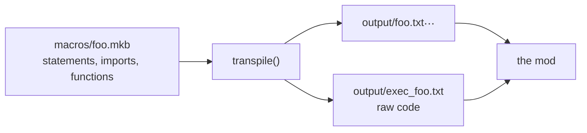

# MKB — the language you write

MKB is the source language of this project: `.mkb` files that the transpiler
turns into the mod's `.txt` scripts.

It is a thin language. It adds five things to the
[original language](../original-language/README.md) — modules, functions,
automatic local scoping, an optional `;`, and a file format with no markers —
and then gets out of the way: what comes out is ordinary original-language code,
line for line.

> MKB may reference the [original language](../original-language/README.md);
> the original language never references MKB.

## What it compiles to



The full nine-stage pipeline is in [usage.md](usage.md#the-pipeline).

## The five additions

| | MKB | Becomes |
| --- | --- | --- |
| File | plain lines, no `$${ … }$$` needed | one wrapper around everything |
| Statements | one per line, `;` optional | `;` appended where missing |
| Comments | `// …` anywhere | kept; a trailing one moves above its statement |
| Modules | `import commons.math;` | module contents spliced in, before your code |
| Functions | `function f(a); … endfunction;` | body inlined at every call |
| Locals | automatic | `<name>_scope_<function>` |

## Quick start

```mkb
function greet(&who);
    log("hello %&who%");
endfunction;

greet("world");
```

```bash
python3 mkb.py                    # every macros/*.mkb → output/*.txt
```

```txt
$${
// [Transpiler] greet(&who)
&who_scope_greet = "world";

log("hello %&who_scope_greet%");
}$$
```

Three things happened: the definition vanished, the call became its body, and
the local was renamed so a second function can also use `&who`.

## Reading order

| Page | Answers |
| --- | --- |
| [syntax.md](syntax.md) | how a file is written: statements, `;`, comments, blank lines, variables, blocks, and what is *not* MKB |
| [modules.md](modules.md) | `import`: syntax, the leading-block rule, resolution order, dedupe, what gets spliced where |
| [functions.md](functions.md) | declaring functions, by-value vs by-reference parameters, defaults, scope renaming, keyword shadowing, expansion limits |
| [usage.md](usage.md) | running the transpiler: the pipeline, `transpile()`, `TranspilerConfig`, the header, `foo.txt` vs `exec_foo.txt`, `server.py`, the editor, troubleshooting |
| [reference/commons.md](reference/commons.md) | the module library in `macros/commons/`, function by function |

## The boundary

| | |
| --- | --- |
| **This doc set** | the language you write, and the tool that compiles it. |
| **[../original-language/](../original-language/README.md)** | the mod's own language: keywords, events, slots, variables. Valid on its own, for somebody who has never heard of MKB. |
| **[../validation.md](../validation.md), [../lint-mkb.md](../lint-mkb.md)** | the rule catalogues of the two checkers. |

A sentence here may say "this compiles to `look(...)`". A sentence there may
never say "this comes from MKB".

## When the language changes

A new construct is done when it has: its stage in `mkb/`, its paragraph here,
its linter rule in [lint-mkb.md](../lint-mkb.md) if it can be checked, and a
fixture in [`tests/fixtures/mkb/`](../../tests/fixtures/mkb/).
`tests/test_fixtures.py` maps every feature to its fixture and fails when one is
missing; `tests/test_doc_library.py` keeps
[reference/commons.md](reference/commons.md) in step with the library.

