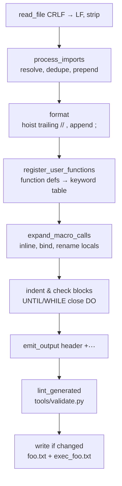

# Using the transpiler

`.mkb` in, `.txt` out.

```bash
python3 mkb.py                    # transpile every macros/*.mkb into output/
python3 server.py                 # same, but keep watching for changes
python3 -m unittest discover -s tests -v
```

| Command | What it does |
| --- | --- |
| `mkb.py` | Transpiles `macros/*.mkb` → `output/`, always overwriting. Prints `Error transpiling <file>: …` and **carries on** — the exit code is still `0`. |
| `server.py` | Watches a directory and re-transpiles each file when it changes. This is the mode to leave running while editing. |
| `python3 -m mkb` | Not implemented yet; use `mkb.py` or the API below. |

## `server.py`

```
python3 server.py [--input-dir macros] [--output-dir output]
                  [--poll-interval 1] [--strict] [--no-header] [--force] [--verbose]
```

| Option | Default | Effect |
| --- | --- | --- |
| `--input-dir` | `macros` | Directory to watch for `.mkb` files. |
| `--output-dir` | `output` | Where the `.txt` files are written. |
| `--poll-interval` | `1` | Seconds between checks. |
| `--strict` | off | A generated script that fails validation is an error: nothing is written and the failure is logged. |
| `--no-header` | off | Omit the provenance header (see [below](#header)). |
| `--force` | off | Rewrite even when the content is unchanged. |
| `--verbose` | off | Print per-file diagnostics. |

`--strict` is what makes the watcher a build step rather than a convenience: an
invalid script is reported and **not written**, so it cannot reach the mod
folder. See [validation.md](../validation.md#build-time-integration).

## The API

```python
from mkb import transpile

changed, text = transpile("macros/tool.mkb", "output", strict=True)
```

`transpile(file, file_out_dir=None, **kwargs) -> (changed, code)`:

| Argument | Meaning |
| --- | --- |
| `file` | Source path. Missing file → `FileNotFoundError`. |
| `file_out_dir` | Output directory, created if needed. Default: `output/` next to the package. |
| `**kwargs` | Any [configuration](#configuration) field. |
| returns | `(changed, code)` — whether the file was rewritten, and the wrapped script as a string. |

It raises `ValueError` for an unresolvable import, an unclosed block, runaway
recursion, and — under `strict` — for a generated script that fails validation.

Lower-level entry points are importable too, mostly for tests and tooling:

```python
from mkb import read_file, read_imports, lint_generated
```

## Configuration

`TranspilerConfig` (in `mkb/config.py`), passed as keyword arguments:

| Field | Default | Effect |
| --- | --- | --- |
| `header` | `True` | Write the provenance comment block. |
| `strict` | `False` | Turn generated-script validation errors into exceptions. |
| `verbose` | `True` | Print per-file messages and diagnostics. |
| `force` | `False` | Rewrite even when the output is byte-identical. |
| `max_depth` | `15` | Expansion passes before "Stack overflow". |
| `VERSION` | `"0.2.0"` | Printed in the header. |

## The pipeline

`transpile()` runs nine steps. Every one of them is a stage in `mkb/`, and every
one can be read on its own.



| # | Stage | Module | What can go wrong |
| --- | --- | --- | --- |
| 1 | Read | `utils.read_file` | — |
| 2 | Imports | `resolver.process_imports` | `Module <x> not found` |
| 3 | Format | `compiler.transpile` | — |
| 4 | Register | `macro_engine.register_user_functions` | nothing; a definition is just removed and remembered |
| 5 | Expand | `macro_engine.expand_macro_calls` | `Stack overflow` |
| 6 | Blocks | `compiler.transpile` | `Invalid block. Unclosed blocks: [...]` |
| 7 | Emit | `emitter.emit_output` | — |
| 8 | Validate | `compiler.lint_generated` | `<name> generated an invalid script: …` (fatal under `strict`) |
| 9 | Write | `compiler.transpile` | — |

Step 3 is the only place where the text of a line is touched: a trailing
`// comment` is moved above the statement, and `;` is appended when missing.
Everything else either adds lines, removes lines, or replaces a line.

## Header

Every generated file starts with four comment lines (inside the block for
`foo.txt`):

```txt
$${
// [Transpiled by MKB Transpiler v0.2.0]
// Source: macros/test.mkb
// Date: 2026-11-01 11:10:16
// Options: strict=False, verbose=False

…code…
}$$
```

* **Inside the block.** A `//` line outside `$${ … }$$` is chat text for the
  mod, so the header would be typed into chat on every run.
  `tools/validate.py` reports that mistake as `W005`.
* `Source` is the path relative to the repository root.
* `Date` only advances when the content actually changes: the unchanged-check
  ignores the date, so re-running an unchanged macro writes nothing.
* `Options` reflects the configuration, so switching `--strict` regenerates the
  file.
* Turn the whole header off with `header=False` / `--no-header`, e.g. for
  byte-comparable fixtures.

## Outputs

For `macros/foo.mkb` the transpiler writes two files into the output directory:

| File | Contents | Use |
| --- | --- | --- |
| `foo.txt` | header + `$${\n…\n}$$` | The macro you load in the mod. |
| `exec_foo.txt` | header + the same code **without** the wrapper | Passed to `EXEC("exec_foo.txt", …)` from another macro. |

* Both are written together, and only when the content changed (unless `force`).
* `macros/commons/*.mkb` are modules, not macros: transpiling them produces an
  almost empty script, and nothing needs them at runtime. The library's
  `reload()` relies on `exec_<macro>.txt` existing for the macros it restarts.

## Validation, layer by layer

Four questions, four tools — see the [linter](../lint-mkb.md) and
[validator](../validation.md) references for the rule catalogues.

| Layer | Tool | Question | When |
| --- | --- | --- | --- |
| Transpiler internals | stages 2, 5, 6 | can this source be built at all? | always |
| Generated script | `tools/validate.py`, via stage 8 | is the output valid for the mod? | every transpile; fatal with `strict` |
| Source lint | `tools/lint_mkb.py` | will this macro do what I meant? | while writing, in the editor |
| Editor | `vscode-extension/` | same as the linter, per keystroke | while typing |

## Editor

The extension in `vscode-extension/` provides the grammar, snippets, completion
against `functions.json`, and inline diagnostics from the linter.

| Setting | Default | Effect |
| --- | --- | --- |
| `mkb.pythonPath` | `python3` | Interpreter used to run the linter. |
| `mkb.lintOnType` | `true` | Lint while typing (400 ms debounce). |
| `mkb.validateScripts` | `true` | Also validate the generated script. |
| `mkb.lintWorkspaceOnStartup` | `true` | Lint the whole workspace once at startup. |
| `mkb.timeoutMs` | `10000` | Linter timeout. |

Commands: `MKB: Lint current file`, `MKB: Lint workspace`.

## Troubleshooting

| Message | Cause | Fix |
| --- | --- | --- |
| `Module <commons.math> not found (imported by …)` | Typo, or the file is not in a directory the resolver searches. | Check the name; see [modules.md](modules.md#resolution). |
| `Invalid block. Unclosed blocks: [['ENDIF', …]]` | A block was opened and never closed. | Add the closer; `LOOP`, `UNTIL(...)` and `WHILE(...)` all close `DO`. |
| `Stack overflow. Check for recursive functions.` | Expansion did not converge within `max_depth`. | Break the cycle; MKB has no runtime recursion. |
| `<foo.txt> generated an invalid script: 3 error(s); first at line 12: …` | The output is not valid original-language code (under `strict`). | Fix the reported line; the message is the validator's. |
| `Error transpiling foo.mkb: …` | Any of the above, from `mkb.py`. | Same fix; note `mkb.py` continues and exits `0`. |
| `unknown keyword 'print' — did you mean SPRINT?` | `print` is defined by `commons.commons`, which was not imported. | `import commons.commons;` — the linter proposes exactly this (`M003`). |
| An `import …;` line survived into the output | It was written after a normal statement. | Move it to the top (`M002`). |

## Next

* [syntax.md](syntax.md) — what you may write.
* [modules.md](modules.md) — `import`.
* [functions.md](functions.md) — declaring and expanding functions.
* [../validation.md](../validation.md), [../lint-mkb.md](../lint-mkb.md) — the rule catalogues.
